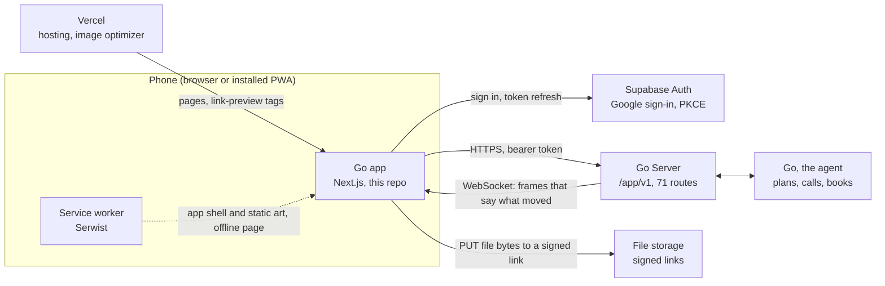

# Go: architecture

Go is a group-trip agent. A friend group plans a trip in one chat with "Go", an AI agent that proposes dates, places, stays and travel, runs the votes, books what the group agrees on, and keeps one budget. This repository is the **app**: a mobile-first, installable PWA.

| | |
| --- | --- |
| Live build | https://go.vestra.ai (sign in with Google) |
| This repo | The app (Next.js 16, React 19, TypeScript, Tailwind 4) |
| Talks to | The Go Server over HTTP and one WebSocket; Supabase Auth for sign-in |
| API contract | The App ↔ Server contract, rev 4, 71 routes. The Server team maintains it outside this repository; `CONTRACT-APP §n` in code comments cites its sections. |

## 1. The system

The product has three parts. Only the first lives in this repository.



- **The app** draws what the Server says and sends what people tap. It holds no trip data of its own and makes no decisions about a trip.
- **The Go Server** owns every trip: people, messages, votes, bookings, money. It is the only thing the app calls.
- **Go, the agent** sits behind the Server. The app never talks to it directly. Go appears in the app as an author of messages and of **cards** (section 5).

## 2. Stack

| Concern | Choice |
| --- | --- |
| Framework | Next.js 16.4 App Router, Turbopack, React 19.3, TypeScript 5.9 |
| Styling | Tailwind CSS 4 (tokens in `@theme`), `class-variance-authority` for variants |
| Primitives | `radix-ui`, `vaul` (bottom sheets), `sonner` (toasts) |
| State | `zustand` + `immer`, nothing persisted |
| Auth | `@supabase/supabase-js`, Google OAuth with PKCE |
| PWA | Serwist (`@serwist/turbopack`): manifest, service worker, offline page |
| Documents | `pdfjs-dist` renders a booking's ticket PDF inside the app |
| Icons | SVG files turned into React components by `@svgr/cli` |
| Hosting | Vercel |

## 3. Layers

Data moves in one direction. Each layer only knows the one below it.

```
src/app            routes: thin pages, a guard, a screen component
src/components     what is drawn: ui atoms → shell → feature sections
src/state/*View.ts adapters: contract objects → what the components draw
src/state          store (zustand), actions (every read and write), sync (session + live frames)
src/api            the contract: wire types, one fetch wrapper, 71 endpoint functions, the WebSocket
```

### `src/api`: the contract, typed

| File | What it is |
| --- | --- |
| `contract.ts` | Every wire shape of the contract as TypeScript types (about 1,100 lines). Field names are the Server's. |
| `endpoints.ts` | One function per route, in the contract's order. Nothing else builds a URL. |
| `http.ts` | The single `fetch` wrapper (below). |
| `live.ts` | The single WebSocket (section 4). |
| `env.ts` | The Server's base URL and the Supabase project, from `NEXT_PUBLIC_*`. |

`http.ts` does four things for every call:

1. Adds the Supabase access token as a bearer token.
2. Adds an `Idempotency-Key` to every write. A caller can pass its own key so that a retry of the same press is the same write.
3. Turns the Server's error body into one `ApiError` type with a message that is safe to show.
4. On a 401, refreshes the session once and retries with the same key. If that also fails, the app signs out.

### `src/state`: a copy of the Server's answers

`store.ts` holds one zustand store. Nothing in it is a source of truth: each field is a copy of an answer and is replaced when the Server says it moved. Nothing is written to disk, so a reload starts from the Server again.

`actions.ts` holds every read and write the screens make. Three rules keep the copy honest:

- **One request per resource at a time.** A second caller gets the first call's promise.
- **An older answer never replaces a newer one.** Every trip read returns the change number (`seq`) it matches, and a slower, older answer is dropped.
- **A write applies the Server's answer, not a guess.** The two exceptions are a sent message and a vote, which show at once (below).

`*View.ts` files are adapters. They turn contract objects into the view models the components draw and compute the labels ("Fri 6 – Mon 9 Nov", "in 34 days", "₹21.8k"). Money arrives in minor units and is converted here.

### `src/components`: atoms first

- `ui`: buttons, chips, inputs, tabs. Built first, with `cva` variants.
- `shell`: the phone frame, screens, top bar, bottom sheet, sticky docks.
- `common`: composites shared across screens.
- `chat`, `sheets`, `trip`, `home`, `plan`, `money`, `checkin`, `board`: one folder per feature.

### `src/app`: routes

Pages are client components with one guard each: `useRequireSession` for signed-in screens, `useTripGate` for trip screens (signed in, the trip read, kept live). The one piece of server rendering is the invite link (section 6).

| Route | Screen |
| --- | --- |
| `/` | Welcome and sign-in |
| `/home` | App home: my trips, ideas |
| `/invite/[code]`, `/j/[code]` | An invite link |
| `/trips/new` | Who's coming |
| `/trips/[tripId]` | Trip home, with itinerary, bookings and expenses tabs |
| `/trips/[tripId]/chat` | The room: the group and Go |
| `/trips/[tripId]/bookings/[bookingId]/ticket` | Ticket viewer |
| `/trips/[tripId]/expenses/transactions` | Transactions |
| `/trips/[tripId]/checkin/pass` | Boarding pass |
| `/profile` | Profile, default city, Go's vault |

## 4. Live updates

The app keeps **one WebSocket** per signed-in instance. It carries every open trip plus the home screen.

The key decision: **the socket is a hint, never the data**. Writes always go over HTTP. A frame mostly says "this moved", and the app then re-reads the same endpoints it would read on a cold start. A missed frame can therefore delay a screen but can never leave it wrong.

| Frame | What the app does |
| --- | --- |
| `message` | Puts the message in the room by its `seq`. |
| `card` | Replaces one of Go's cards in place. |
| `typing` | Shows "Go is thinking" or a person typing, with a timeout. |
| `trip_changed` | Re-reads the named parts of the trip (debounced, one read for a burst). |
| `home_changed` | Re-reads `/home` (debounced). |
| `resync` | Re-reads the whole trip. |

How the connection stays correct:

- **Ticket per connect.** The socket opens with a single-use ticket from `POST /live/ticket`, so the access token never goes into a URL.
- **Change numbers.** Every trip has a rising `seq`. The app subscribes with the last `seq` it holds, and the Server replays what was missed.
- **Gap detection.** A frame whose `seq` jumps by more than one triggers a re-read before the app trusts the socket again.
- **Reconnect.** Backoff of 1, 2, 5, 10, then 30 seconds; at once when the app returns to the front or the network returns.
- **Heartbeat.** Two missed pings close the socket even if it still looks open.
- **Resume.** Coming back to the app re-reads home and every open trip, whatever the socket did meanwhile.

### The two optimistic writes

- **Sending a message.** It appears at once as "sending" under a `client_message_id`. A file is uploaded first to a signed link, then the message is posted. A retry reuses the same id, so a send that did reach the Server is not posted twice. If the socket delivers my own message before the POST answers, the "sending" twin is hidden.
- **Voting.** My pick shows at once. Taps on one vote are sent one at a time, in order, and only the last tap of a burst is sent. If the Server refuses, the pick goes back to the last vote it confirmed.

## 5. Cards: how the agent appears in the app

Go speaks in messages and in **cards**, and a card is the unit of the agent's work. `components/chat/CardView.tsx` maps each contract card kind to a component. There are two families:

| Family | Kinds | Drawn from |
| --- | --- | --- |
| Record cards | `vote`, `mandate`, `ticket`, `expense`, `settle_up`, `day`, `plan`, `budget` | The Server's own row, by id. The chat and the trip screens read the same row, so they cannot disagree. |
| Go cards | `options`, `working`, `call`, `pay`, `notice`, `checklist`, `rooms` | The card itself. Go replaces it in place with a `card` frame as its work moves on. |

What this gives the product:

- **Go shows its work.** A `working` card lists the steps of a longer job and updates as each one finishes. It can carry a live stream of Go's screen, which opens full height in a sheet.
- **Buttons are the Server's.** A card names its own actions and who may press them. One press is one `POST …/cards/:id/actions` with its own key.
- **Go's pages open inside the app.** When Go needs a person on a web page (its vault for cards and logins, a sign-in), the page is framed in a full-screen bottom sheet and tells the app when it is done through `postMessage`.
- **Unknown kinds degrade.** Every card carries `fallback_text`. A kind this build does not know is shown as that text, so the Server can ship a new card before the app does.
- **Feature flags.** `GET /config` returns flags (`checkin`, `visa`, `calls`, `vote_retract`, `vote_flexible`, `claim`) that hide what a deployment has not switched on.

## 6. Sign-in, invites and security

- **Sign-in** is Supabase Auth with Google, using PKCE. The Server issues no tokens of its own. `src/lib/auth.ts` is the only file that touches the session.
- **Return paths** after sign-in accept same-app paths only (`safeNextPath`), never an absolute URL.
- **Requests** send three headers (Authorization, Content-Type, Idempotency-Key) and no cookies (`credentials: "omit"`).
- **Links from the Server** are followed only when they are `https://` or `go://` (a named screen of the app). Nothing else is opened.
- **Trips I am not in** answer 403, the same as a trip that does not exist, and the app shows not-found for both.
- **Invite links** are the one server-rendered piece. `invite/[code]/layout.tsx` reads the public invite preview on the web server and sets the Open Graph tags, so a link pasted into WhatsApp or iMessage shows the trip's cover (through Next's image optimizer, to stay under messenger size limits) or the mascot.
- **Configuration** is three `NEXT_PUBLIC_*` values, all public by design: the Supabase URL and anon key, and the Server's base URL. No secret lives in this repository or in the browser bundle.

## 7. Mobile shell and PWA

- **One 450px column.** The app lives in `#app-frame`, centred on wider screens. The document is the only page scroller, so `sticky` headers and docks work like a native app.
- **One overlay layer.** Sheets, menus and toasts portal into `#overlay-layer`, a fixed column with a transform that contains every fixed descendant, so nothing escapes the phone frame on desktop.
- **Installable.** `manifest.ts` and the icon set make the app installable on iOS and Android.
- **Service worker.** It precaches the app shell, caches the app's own art, and serves `/~offline` when a page cannot load. Calls to the Server and to Supabase are `NetworkOnly`: a person's data is never answered from a cache. The worker runs in production builds only.

## 8. Running it

```bash
cp .env.example .env.local   # fill in the Supabase URL and anon key
pnpm install
pnpm dev                     # http://localhost:3000
```

```bash
pnpm lint && pnpm typecheck && pnpm build
```

The origin the app runs on must be in the Server's `APP_ORIGINS`, and `<origin>/auth/callback` must be an allowed redirect in the Supabase project. See [`README.md`](README.md) for the scripts, the icon pipeline and the design rules.

## 9. Repository map

| Path | What it holds |
| --- | --- |
| `src/api` | The contract: types, HTTP, endpoints, WebSocket |
| `src/state` | Store, actions, sync, view adapters |
| `src/app` | Routes, manifest, service worker |
| `src/components` | UI atoms, shell, feature sections, icons |
| `src/lib` | Auth, links, sharing, dates, formatting |
| `src/data` | View-model types, UI copy, static config. No trip data. |
| `public` | The app's own art, icons and PWA icons |
| `plans` | The build plan and screen specs of the first prototype (8 Oct), kept as history |
